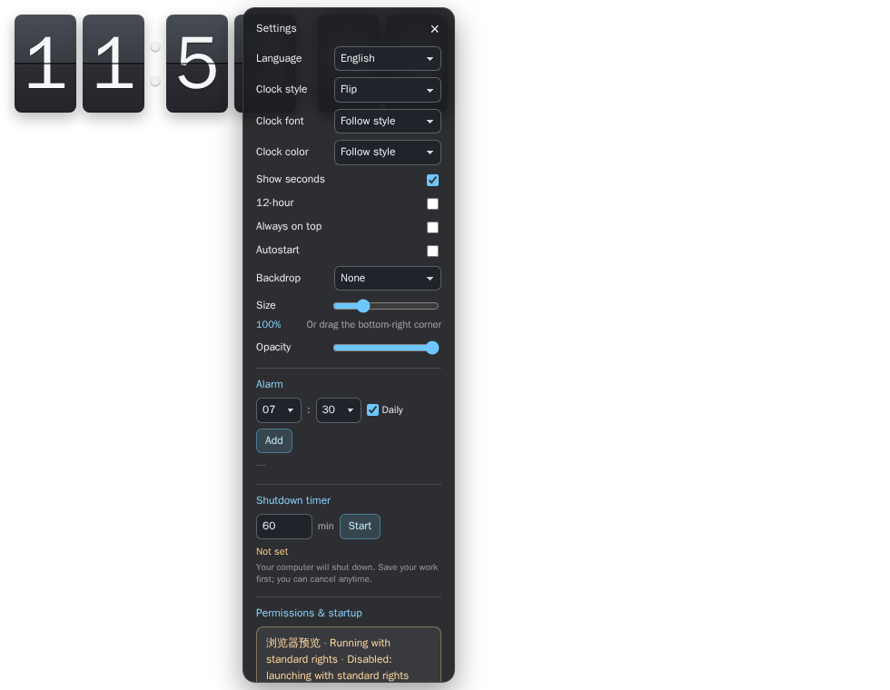

# Desk Clock · 桌面时钟

一个**开源免费**的桌面时钟：只显示时间，可选是否显示秒，8 种社区流行样式，低资源占用、稳定、无边框透明窗口，支持开机自启、记住窗口位置与大小，一套代码跨 **Windows / macOS / Linux**。

> 协议 [MIT](LICENSE) ｜ 界面**默认简体中文，支持中英双语切换** ｜ 由公共仓库的 GitHub Actions 免费自动打包全平台安装包。

## 效果预览

主界面（`flip` 翻页卡片，透明无边框、无黑底）：


<details>
<summary>展开查看全部 8 种样式</summary>

| 极简细体 | 霓虹 | 电子墨水 |
|---|---|---|
|  |  |  |

| 七段数码 | 打字机 | 毛玻璃 | 指针表盘 |
|---|---|---|---|
|  |  |  |  |

</details>

设置面板（中文 / English 一键切换）：

| 简体中文（默认） | English |
|---|---|
|  |  |

> 截图为透明底，深色背景仅为查看器底色；真实桌面上时钟悬浮于壁纸之上。

## 功能

| 能力 | 说明 |
|---|---|
| **8 种样式** | 翻页卡片 / 极简细体 / 霓虹 / 电子墨水 / 七段数码 / 打字机 / 毛玻璃 / 指针表盘，每种都预设了推荐的字体与颜色搭配 |
| **字体与颜色** | 可选预设字体/颜色，也可用取色器与字体名完全自定义；选「跟随样式（推荐）」即回到该样式的最佳搭配 |
| **一键还原默认** | 设置面板底部按钮，或快捷键 **Alt+R**（保留当前语言与窗口位置） |
| **中英双语** | 默认简体中文，设置面板第一项可切 English，界面文字与所有下拉项同步切换 |
| **大小可调** | 设置面板滑块（50%–250%），或直接**拖动窗口右下角**；尺寸与位置都会被记住 |
| **位置记忆** | 开机自启后自动恢复到上次位置与大小；拔掉显示器导致越界时自动回中 |
| **闹钟** | 可添加多个时间点，支持「每天重复」与一次性；到点弹出提醒，可稍后提醒（5 分钟）或关闭 |
| **定时关机** | 设置分钟后启动，随时可取消；Windows 走系统原生 `shutdown /s /t`，Linux/macOS 需相应系统权限（不支持时如实提示） |
| **托盘常驻**（v0.3） | 不占任务栏图标；关闭窗口只是隐藏，托盘菜单可重新显示 / 打开设置 / 退出，左键点托盘直接唤出时钟 |
| **独立设置窗口**（v0.3） | 右上角齿轮打开独立的原生设置窗口，可拖拽、可调整大小，与时钟互不遮挡；两窗口设置实时同步 |
| **管理员权限**（v0.3，Windows） | 设置窗口内实时显示当前权限状态；勾选后每次启动（含开机自启）自动请求管理员，也可一键「立即以管理员身份重启」；macOS/Linux 如实提示不支持自动提权 |
| **打赏支持**（v0.3） | 设置窗口与托盘菜单均可打开微信支付 / 支付宝收款码，完全自愿 |
| 显示秒 / 12 小时制 | 关秒后每分钟只唤醒一次，更省电 |
| 总在最前 / 开机自启 | 由 Tauri 原生插件接管，勾选状态回读系统真实值 |
| 背景板 | 默认全透明；可选模糊 / 暗色 / 浅色（都是极低透明度，不是黑底） |
| 不透明度 | 30%–100% |

## 为什么是这个架构

| 需求 | 做法 |
|---|---|
| 减少系统资源占用 | **Tauri v2** 复用系统自带 WebView（Win=WebView2 / macOS=WKWebView / Linux=WebKitGTK），不打包第二个 Chromium；Rust 壳只管窗口/托盘/自启/位置/尺寸，没有常驻轮询 |
| 稳定 | 前端零框架、零打包器、零 ES module、零运行时依赖；全部传统 `<script>` 挂全局命名空间，`file://` 直接打开也能跑；偏好写入用「临时文件 + 原子 rename」，断电不会写坏 |
| 低 CPU | 不用 `setInterval`；每次 tick 后计算到下一个整秒/整分，用**单次 `setTimeout`** 唤醒；关秒时每分钟只醒一次；窗口隐藏/最小化暂停；翻页动画只在真正变化的数位触发 |
| 不要黑色背景 / 不要边框 | 透明窗口（`transparent:true` + `decorations:false`）+ 页面 `background:transparent`；翻页卡片浮在透明背景上，时钟主体**无任何外框/描边/黑底** |
| 多系统 | 同一份 Rust + 静态前端，三系统各自原生打包（GitHub Actions 四目标矩阵） |

## 下载安装包

到 **[Releases](https://github.com/xiaoqiangclub/desk-clock/releases)** 下载对应平台：

| 平台 | 文件 | 安装 |
|---|---|---|
| Debian / Ubuntu / Mint | `*.deb` | `sudo apt install ./*.deb` |
| Fedora / RHEL / openSUSE | `*.rpm` | `sudo dnf install ./*.rpm` |
| 通用 Linux | `*.AppImage` | `chmod +x *.AppImage && ./*.AppImage` |
| Windows | `*.msi` 或 `*-setup.exe` | 双击安装 |
| macOS Intel | `*x64.dmg` | 拖入 Applications |
| macOS Apple Silicon | `*aarch64.dmg` | 拖入 Applications |

> 安装包**未做代码签名**：macOS 首次打开需右键→打开（或 `xattr -cr "Desk Clock.app"`），Windows 可能弹 SmartScreen，点「仍要运行」即可。
>
> 每次 push 代码也会在 [Actions](https://github.com/xiaoqiangclub/desk-clock/actions) 产出全平台构建产物；推 `v*` 标签自动发布 Release。

## 目录

```
ui/                 静态前端（index.html + i18n / prefs / fonts / alarm / flip / clock / app + styles.css）
src-tauri/          Tauri v2 Rust 壳（窗口 / 偏好持久化 / 位置与尺寸恢复 / 自启 / 定时关机）
docs/SPEC.md        设计契约（模块接口、8 种样式、验收标准）
scripts/dev.sh      开发运行
scripts/build.sh    出各平台安装包
scripts/preview.sh  无头 Chromium 截图验收
scripts/verify.py   31 项功能 + 视觉回归
scripts/verify_features.py  40 项新功能回归（双语/字体色/还原/闹钟/关机/拖拽）
.preview/           8 张样式截图 + 中英设置面板截图
```

## 本地开发

只想看长什么样（不需要 Rust）：浏览器直接打开 `ui/index.html`，或

```bash
bash scripts/preview.sh          # 生成 .preview/*.png 八张样式截图
python3 scripts/verify.py        # 31 项回归
python3 scripts/verify_features.py  # 40 项新功能回归（需 playwright + chromium）
```

装成桌面程序，前置（各系统一次）：

- 通用：[Rust ≥ 1.77](https://rustup.rs) + `cargo install tauri-cli --version '^2.0.0' --locked`
- Linux(Debian/Ubuntu)：`sudo apt install libwebkit2gtk-4.1-dev build-essential curl wget file libxdo-dev libssl-dev libayatana-appindicator3-dev librsvg2-dev`
- Windows：WebView2 Runtime（Win11 自带）+ MSVC Build Tools
- macOS：Xcode Command Line Tools

```bash
bash scripts/dev.sh       # 开发运行
bash scripts/build.sh     # 出安装包（产物在 src-tauri/target/release/bundle/）
```

## 使用

- 无边框窗口，**按住时钟任意空白处拖动**；
- **拖动右下角**调整大小；
- 点右上角齿轮打开设置（鼠标移入才显示）；
- 「Alt+R」随时一键还原默认外观。

## 状态

- [x] 架构 / 设计契约
- [x] Tauri v2 壳（透明无边框窗口、偏好原子持久化、位置/尺寸恢复与越界兜底、自启、置顶权限）
- [x] 静态前端（8 样式、翻页 3D 动画、单次 setTimeout 引擎、设置面板）
- [x] 中英双语界面（默认简体中文）
- [x] 字体与颜色自定义 + 每样式推荐默认 + 一键还原（按钮 / Alt+R）
- [x] 大小可调（滑块 + 右下角拖拽）、位置与尺寸记忆
- [x] 闹钟（多条 / 每天 / 一次 / 稍后提醒）、定时关机（可取消）
- [x] 无头 Chromium 回归：31/31 + 40/40 PASS
- [x] **Linux / Windows / macOS 全平台安装包**由 GitHub Actions 自动构建
- [x] **发布到 GitHub Releases**（推 `v*` 标签自动发布）

## 开源

- 协议：[MIT](LICENSE)
- 自动打包：`.github/workflows/build.yml`；自动发版：`.github/workflows/release.yml`
- 欢迎 PR；提交前请先跑 `python3 scripts/verify.py`、`python3 scripts/verify_features.py` 与 `bash scripts/build.sh`。
