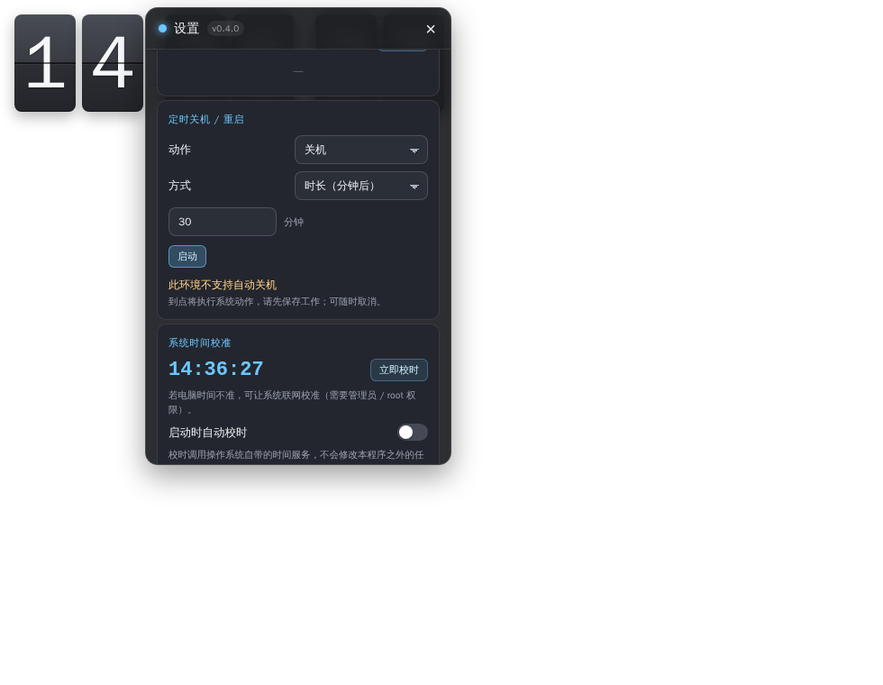
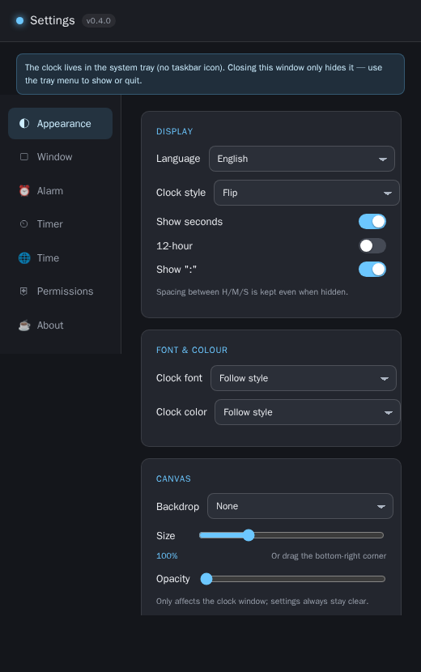

# Desk Clock · 桌面时钟

一个**开源免费**的桌面时钟：8 种社区流行样式，无边框透明窗口，低资源占用，支持**任意多个窗口且每个窗口都有全套独立设置**（样式、颜色、字体、大小、时区、位置、鼠标穿透等），以及闹钟、定时关机/重启、系统校时、开机自启。一套静态前端 + 一个 Tauri v2 Rust 壳，跨 **Windows / macOS / Linux**。

> 协议 [MIT](LICENSE) ｜ 界面**默认简体中文，支持中英双语切换** ｜ 当前版本 **v0.6.1**，安装包由公共仓库的 GitHub Actions 自动打包全平台。

## 效果预览

主界面（`flip` 翻页卡片，透明无边框、无黑底）：


<details>
<summary>展开查看全部 8 种样式</summary>

| 极简细体 | 霓虹 | 电子墨水 |
|---|---|---|
|  |  |  |

| 七段数码 | 打字机 | 毛玻璃 | 指针表盘 |
|---|---|---|---|
|  |  |  |  |

</details>

设置窗口（左侧 Tab 导航 + 卡片分组）：

| 简体中文（默认） | 独立设置窗口 |
|---|---|
|  |  |

> 上述设置界面截图为早期版本：v0.6.1 已把「多时区」并入「窗口」页、精简了添加窗口表单、并移除了头部「设置」二字。时钟主体样式截图仍为当前效果。
>
> 截图背景为查看器底色；真实桌面上时钟悬浮于壁纸之上，无任何外框或黑底。

## 功能

| 能力 | 说明 |
|---|---|
| **8 种样式** | 翻页卡片 / 极简细体 / 霓虹 / 电子墨水 / 七段数码 / 打字机 / 毛玻璃 / 指针表盘，每种都有推荐的字体与颜色搭配 |
| **字体与颜色** | 预设字体/颜色，或取色器与自定义字体名；选「跟随样式」即回到该样式最佳搭配 |
| **显示项** | 显示秒、12/24 小时制、显示/隐藏 `:`（隐藏时仍保留时分秒间距）、表盘深浅两套配色、指针穿透 |
| **字体缩放** | 设置滑块 50%–250%，或直接拖动窗口右下角；尺寸与位置都会被记住 |
| **背景板与不透明度** | 默认全透明；可选模糊 / 暗色 / 浅色（都是极低透明度，不是黑底）；不透明度仅作用于时钟窗口，设置窗口始终清晰 |
| **总在最前 / 开机自启** | 由 Tauri 原生插件接管，勾选状态回读系统真实值 |
| **位置记忆** | 每个窗口各自记住位置；开机自启后分别恢复，拔掉显示器导致越界时自动回中 |
| **快速定位** | 九宫格一键把**当前编辑的窗口**放到屏幕常用位置（按当前显示器工作区计算） |
| **闹钟**（v0.4 增强） | 多个时间点、每天重复或一次性；到点弹出提醒卡并播放提示音（可静音/关闭），可稍后提醒 5 分钟；5 种预设铃声 + 自定义音频（≤500KB，仅存本机） |
| **定时关机 / 重启**（v0.4） | 关机或重启、时长模式（N 分钟后）或时间点模式（如 23:00，跨天取次日），随时可取消 |
| **系统时间校准**（v0.4） | 实时显示本机时间；「立即校时」调用系统自带时间服务，可勾选「启动时自动校时」（需管理员 / root，失败如实提示） |
| **自动升级检查**（v0.4） | 打开设置窗口时静默检查 GitHub 最新版本，发现新版给出下载入口；也可手动「检查更新」 |
| **托盘常驻**（v0.3） | 不占任务栏图标；关闭窗口只是隐藏，托盘菜单可重新显示 / 打开设置 / 打赏 / 检查更新 / 恢复鼠标 / 退出；左键点托盘直接唤出时钟 |
| **管理员权限**（v0.3，Windows） | 实时显示权限状态；可设开机自动请求管理员或一键「立即以管理员身份重启」；macOS/Linux 如实提示不支持自动提权 |
| **中英双语** | 默认简体中文，设置面板可切 English，界面文字与所有下拉项同步切换 |
| **一键还原默认** | 设置「关于」页按钮或 **Alt+R**；保留当前语言、各窗口位置与**已创建的窗口清单**，只重置设置项 |
| **版本号可点** | 头部版本徽标与「关于」页版本号点击直达 GitHub 项目主页 |
| **支持作者**（v0.4） | 「请作者喝咖啡」→ 微信 / 支付宝收款码；一键跳转 GitHub 项目主页 |

## 多窗口（v0.6 / v0.6.1 架构）

**所有时钟窗口完全平等**，没有「主窗口特殊」这一说：主窗口只是默认存在的那一个，每个窗口都拥有自己的一套完整配置。

- **配置分层**：全局项（界面语言、闹钟与铃声、定时关机/重启、启动时自动校时、开机自启、管理员启动）对所有窗口生效；窗口项（名称、时区、样式、显示秒、12 小时制、分隔符、字体、颜色、表盘配色、指针穿透、背景板、大小、不透明度、总在最前、鼠标穿透、窗口位置、可见性）**每窗口各存一份、互不影响**。
- **窗口管理**：全部集中在设置的「**窗口**」页（v0.6.1 起不再有独立「多时区」Tab）。添加表单只有「名称」+「添加窗口」——因为每个窗口都是全功能窗口，创建后想改什么直接改即可；新窗口**完整继承当前主窗口配置**（含时区），不会凭空变成 UTC+0。
- **窗口清单**：首行恒为主窗口卡片（不可删除、无隐藏按钮），其后是各新增窗口，每行可「设置 / 重命名 / 隐藏或显示 / 删除」。
- **切换编辑目标**：设置窗口头部「正在编辑」下拉框，或点某一行的「设置」按钮。切换后所有控件即代表该窗口。
- **从窗口直接进设置**：任何一个窗口上点齿轮，设置窗口会自动把编辑目标切到该窗口；额外窗口同样有齿轮与缩放柄，可拖动、可点。
- **位置完全独立**：每个窗口只监听自己的移动事件并各记各的坐标；改配置不会把窗口移回旧位置；重启后各窗口分别恢复到自己的位置。
- **鼠标穿透**：按窗口各自配置生效；开启后该窗口不再接收鼠标事件，可用托盘「恢复鼠标（关闭穿透）」一次性恢复所有窗口。

> 配置为 `prefs.json`（全局项与窗口清单）+ `clocks.json`（每窗口完整配置，键为窗口 id）。旧版本配置在首次启动时自动迁移，不丢设置。

## 版本演进

| 版本 | 重点 |
|---|---|
| v0.3 | 托盘常驻、独立设置窗口、权限管理 |
| v0.4 | 闹钟 / 定时关机 / 表盘重绘 / 冒号开关 / 九宫格定位 / 单实例多窗口 / 时区偏移 / 系统校时 / 自动更新检查 |
| v0.5 | 多时区窗口管理器、闹钟铃声、UAC 卡死修复、界面与流畅度优化 |
| v0.5.1 | 额外窗口点击拦截修复、异步建窗、权限状态不再被 i18n 重置 |
| v0.6.0 | **所有窗口完全平等**：`clocks.json` 每窗口完整配置、「正在编辑」目标切换、主窗口也能设时区 |
| v0.6.1 | 窗口管理并入「窗口」页并精简表单、头部布局整理；修复窗口拖不动与「移动一个窗口其它窗口跟着动」；位置/注入值改为每窗口独立 |

> 各版本逐条对照见仓库根目录 `DELIVERY*.md`，安装复测步骤见 `TESTING*.md`。历史文档是当时快照，当前行为以本文件与 `DELIVERY-v0.6.1.md` 为准。

## 为什么是这个架构

| 需求 | 做法 |
|---|---|
| 减少系统资源占用 | **Tauri v2** 复用系统自带 WebView（Win=WebView2 / macOS=WKWebView / Linux=WebKitGTK），不打包第二个 Chromium；Rust 壳只管窗口/托盘/自启/每窗口位置与配置，没有常驻轮询 |
| 稳定 | 前端零框架、零打包器、零 ES module、零运行时依赖；全部传统 `<script>` 挂全局命名空间，`file://` 直接打开也能跑；偏好写入用「临时文件 + 原子 rename」，断电不会写坏 |
| 低 CPU | 不用 `setInterval`；每次 tick 后计算到下一个整秒/整分，用**单次 `setTimeout`** 唤醒；关秒时每分钟只醒一次；窗口隐藏时暂停；翻页动画只在真正变化的数位触发 |
| 不要黑色背景 / 不要边框 | 透明窗口（`transparent:true` + `decorations:false`）+ 页面 `background:transparent`；时钟主体**无任何外框/描边/黑底** |
| 多系统 | 同一份 Rust + 静态前端，三系统各自原生打包（GitHub Actions 四目标矩阵） |

## 下载安装包

到 **[Releases](https://github.com/xiaoqiangclub/desk-clock/releases)** 下载对应平台（当前 v0.6.1）：

| 平台 | 文件 | 安装 |
|---|---|---|
| Debian / Ubuntu / Mint | `*.deb` | `sudo apt install ./*.deb` |
| Fedora / RHEL / openSUSE | `*.rpm` | `sudo dnf install ./*.rpm` |
| 通用 Linux | `*.AppImage` | `chmod +x *.AppImage && ./*.AppImage` |
| Windows | `*.msi` 或 `*-setup.exe` | 双击安装 |
| macOS Intel | `*x64.dmg` | 拖入 Applications |
| macOS Apple Silicon | `*aarch64.dmg` | 拖入 Applications |

> 安装包**未做代码签名**：macOS 首次打开需右键→打开（或 `xattr -cr "Desk Clock.app"`），Windows 可能弹 SmartScreen，点「仍要运行」即可。
>
> 每次 push 代码也会在 [Actions](https://github.com/xiaoqiangclub/desk-clock/actions) 产出全平台构建产物；推 `v*` 标签自动发布 Release。

## 目录

```
ui/                 静态前端（index.html + i18n / prefs / fonts / alarm / flip / clock / app + styles.css）
src-tauri/          Tauri v2 Rust 壳（窗口 / 每窗口配置持久化 / 位置与尺寸恢复 / 自启 / 定时关机）
docs/SPEC.md        初始设计契约（模块接口、8 种样式、验收标准；后续演进见本 README 与 DELIVERY*.md）
scripts/dev.sh      开发运行
scripts/build.sh    出各平台安装包
scripts/preview.sh  无头 Chromium 截图验收
scripts/verify*.py  分版本真实 Chromium 回归（见下）
.preview/           8 张样式截图 + 设置面板截图
```

## 本地开发

只想看长什么样（不需要 Rust）：浏览器直接打开 `ui/index.html`，或

```bash
bash scripts/preview.sh             # 生成 .preview/*.png 八张样式截图
python3 scripts/verify.py           # 31 项基础功能 + 视觉回归
python3 scripts/verify_features.py  # 43 项功能回归（双语/字体色/还原/闹钟/关机/拖拽）
python3 scripts/verify_v03.py       # 35 项 v0.3 托盘/权限回归
python3 scripts/verify_v04.py       # 60 项 v0.4 新功能回归（已适配 v0.6.1 结构）
python3 scripts/verify_v05.py       # 55 项 v0.5 反馈批次回归（已适配 v0.6.1 结构）
python3 scripts/verify_v06.py       # 22 项每窗口独立配置回归
python3 scripts/verify_v061.py      # 30 项 v0.6.1 反馈批次 + 位置独立性回归
# 合计 276 项；需 playwright + chromium
```

装成桌面程序，前置（各系统一次）：

- 通用：[Rust ≥ 1.77](https://rustup.rs) + `cargo install tauri-cli --version '^2.0.0' --locked`
- Linux(Debian/Ubuntu)：`sudo apt install libwebkit2gtk-4.1-dev build-essential curl wget file libxdo-dev libssl-dev libayatana-appindicator3-dev librsvg2-dev`
- Windows：WebView2 Runtime（Win11 自带）+ MSVC Build Tools
- macOS：Xcode Command Line Tools

```bash
bash scripts/dev.sh       # 开发运行
bash scripts/build.sh     # 出安装包（产物在 src-tauri/target/release/bundle/）
```

## 使用

- 无边框窗口，**按住时钟任意空白处拖动**；每个窗口都能单独拖动；
- **拖动右下角**调整大小；
- 点右上角齿轮打开设置（鼠标移入才显示）；从哪个窗口点，就默认编辑哪个窗口；
- 设置 →「窗口」页添加/重命名/隐藏/删除窗口；设置头部「正在编辑」下拉框切换目标；
- 「Alt+R」随时一键还原默认设置（保留语言、窗口位置与窗口清单）。

## 状态

- [x] 架构 / 设计契约、Tauri v2 壳、静态前端 8 样式 + 翻页动画 + 低 CPU 引擎
- [x] 中英双语、字体/颜色自定义、大小与位置记忆、不透明度隔离
- [x] 闹钟（多条 / 每天 / 稍后提醒 / 5 种铃声 + 自定义音频）、定时关机 / 重启、系统校时
- [x] 单实例 + 多窗口 + 20 个常用时区及自定义 UTC 偏移 + 九宫格定位 + 鼠标穿透
- [x] 托盘常驻、独立设置窗口、管理员权限、自动更新检查、打赏页
- [x] **每窗口完整独立配置**（`clocks.json`）、目标切换、位置完全独立、窗口管理并入「窗口」页
- [x] 无头 Chromium 回归：31 + 43 + 35 + 60 + 55 + 22 + 30 = **276 项全绿**
- [x] **Linux / Windows / macOS 全平台安装包**由 GitHub Actions 自动构建并发布 Release

## 开源

- 协议：[MIT](LICENSE)
- 自动打包：`.github/workflows/build.yml`；自动发版：`.github/workflows/release.yml`
- 欢迎 PR；提交前请先跑 `scripts/verify*.py` 与 `bash scripts/build.sh`。
